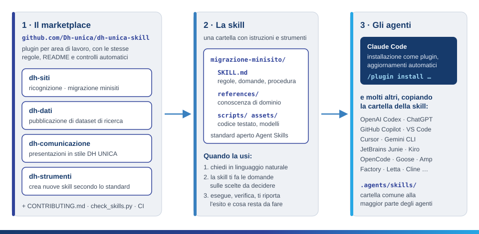
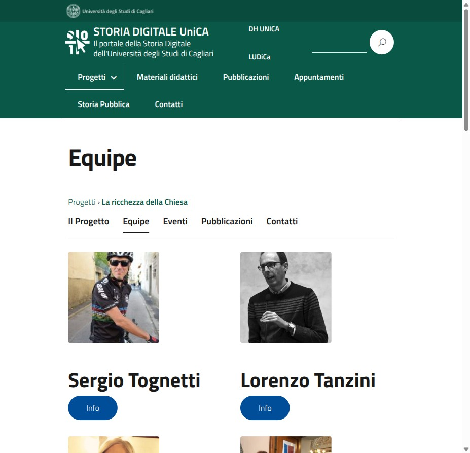
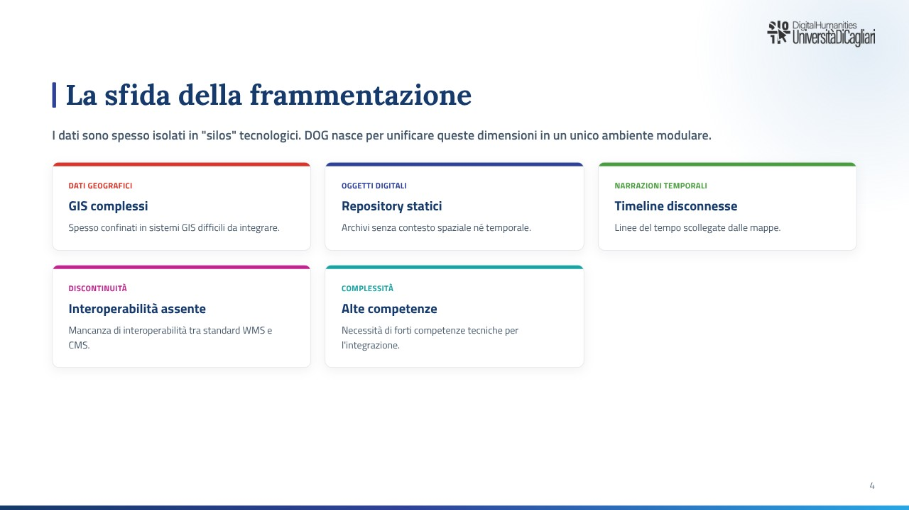

<p align="center">
  <a href="https://dh.unica.it">
    <picture>
      <source media="(prefers-color-scheme: dark)" srcset="docs/img/dh-logo-white.png">
      
    </picture>
  </a>
</p>

<h1 align="center">dh-unica-skill</h1>

<p align="center">
  <strong>Le procedure del Centro DH UNICA, pronte da usare con gli agenti di intelligenza artificiale.</strong>
</p>

<p align="center">
  <a href="https://dh.unica.it"></a>
  <a href="https://storia.dh.unica.it"></a>
  <a href="https://github.com/Dh-unica"></a>
</p>
<p align="center">
  <a href="https://agentskills.io"></a>
  <a href="https://code.claude.com/docs/en/plugins/install"></a>
  <a href="https://github.com/Dh-unica/dh-unica-skill/actions/workflows/validate.yml"></a>
  <a href="LICENSE"></a>
</p>

---

## Perché questo repository

Al [Centro interdipartimentale per l'Umanistica Digitale](https://dh.unica.it) dell'Università di
Cagliari molte attività si ripetono di progetto in progetto:
- riportare dentro i portali del DH il sito di una ricerca nato su un dominio esterno;
- pubblicare un dataset in modo che si possa esplorare e citare;
- preparare una presentazione con l'identità visiva del Centro.

Finora ogni volta si ripartiva da zero: le scelte, le cautele e gli errori già fatti restavano nella
memoria di chi aveva fatto il lavoro.

Questo repository raccoglie quelle procedure come **skill**: istruzioni operative che un agente di IA
segue per conto tuo. Dentro ci sono le regole del DH, per esempio:
- la name convention dei portali `{ambito}.dh.unica.it/{progetto}`;
- la tutela dei dati personali;
- nessuna pubblicazione senza conferma.

Ci sono anche gli strumenti già collaudati sui casi reali. L'obiettivo è:
- **meno lavoro ripetitivo**;
- **risultati uniformi** tra persone e progetti diversi;
- **conoscenza che non si perde** quando le persone cambiano.

## Cos'è una skill

Una skill è una **cartella** con un file `SKILL.md`, che dice all'agente *quando* usarla, *cosa
chiederti* e *come procedere*. Accanto possono esserci:
- materiali di riferimento;
- modelli;
- script già testati.

Non serve conoscere il funzionamento interno: chiedi in linguaggio naturale («porta il sito del
progetto X dentro storia.dh.unica.it») e la skill si attiva da sola. Ti fa le domande sulle scelte che
spettano a te, esegue, verifica e ti riporta l'esito.

<p align="center">
  
</p>

## Catalogo

| Plugin | Comando | A cosa serve | Livello |
|---|---|---|---|
| `dh-comunicazione` | `/dh-comunicazione:creazione-slide` | Genera presentazioni nello stile grafico ufficiale DH UNICA | bozze |
| `dh-dati` | `/dh-dati:pubblicazione-dataset` | Trasforma un dataset di ricerca umanistica in un'app statica esplorabile per GitHub Pages e WordPress | bozze |
| `dh-siti` | `/dh-siti:ricognizione-minisito` | Analizza un minisito di progetto e prepara il piano di migrazione | sola lettura |
| `dh-siti` | `/dh-siti:migrazione-minisito` | Migra un minisito di progetto nel portale `{ambito}.dh.unica.it` | produzione |
| `dh-strumenti` | `/dh-strumenti:crea-skill` | Crea una nuova skill secondo lo standard DH | bozze |
<!-- fine-catalogo -->

**Livello** dice cosa può modificare una skill:
- *sola lettura*: non cambia nulla;
- *bozze*: crea file o contenuti non pubblicati;
- *produzione*: pubblica su servizi reali, sempre dopo la tua conferma e con un modo per tornare indietro.

Ogni plugin ha un README con le stesse sezioni: cosa fa, quando usarla, prerequisiti, domande che ti
farà, cosa modifica, come tornare indietro, sicurezza, limiti.

### Esempi di risultato

<table>
  <tr>
    <td width="50%" valign="top">
      
      <br><sub><b>dh-siti</b>: il sito <i>La ricchezza della Chiesa</i> migrato in
      <a href="https://storia.dh.unica.it/laricchezzadellachiesa/">storia.dh.unica.it/laricchezzadellachiesa</a>,
      con percorso e menu del progetto.</sub>
    </td>
    <td width="50%" valign="top">
      
      <br><sub><b>dh-comunicazione</b>: una slide generata nello stile DH UNICA (deck di esempio sul
      progetto DOG).</sub>
    </td>
  </tr>
</table>

## Compatibilità: non solo Claude

Le skill seguono lo **standard aperto [Agent Skills](https://agentskills.io/specification)**, nato in
Anthropic e adottato da molti agenti. Lo stesso `SKILL.md` funziona, tra gli altri, in:

| Agente | Produttore | Dove si mettono le skill |
|---|---|---|
| [Claude Code](https://code.claude.com/docs/en/skills) | Anthropic | plugin da questo marketplace (consigliato), `.claude/skills/` |
| [Claude (app e API)](https://platform.claude.com/docs/en/agents-and-tools/agent-skills/overview) | Anthropic | caricamento della cartella in archivio zip |
| [Codex e ChatGPT](https://learn.chatgpt.com/docs/build-skills) | OpenAI | `.agents/skills/`, `~/.agents/skills/` |
| [GitHub Copilot](https://docs.github.com/en/copilot/concepts/agents/about-agent-skills) e [VS Code](https://code.visualstudio.com/docs/copilot/customization/agent-skills) | GitHub / Microsoft | `.github/skills/`, `.agents/skills/`, `.claude/skills/` |
| [Cursor](https://cursor.com/docs/context/skills) | Anysphere | `.agents/skills/`, `.cursor/skills/` |
| [Gemini CLI](https://geminicli.com/docs/cli/skills/) | Google | `.agents/skills/`, `.gemini/skills/` |
| [Junie](https://junie.jetbrains.com/docs/agent-skills.html) | JetBrains | `.agents/skills/`, `.junie/skills/` |
| [Kiro](https://kiro.dev/docs/skills/) | AWS | `.kiro/skills/` |
| [OpenCode](https://opencode.ai/docs/skills/) | SST | `.agents/skills/`, `.opencode/skills/` |
| [Goose](https://goose-docs.ai/docs/guides/context-engineering/using-skills) | Block | `.agents/skills/` |
| [Amp](https://ampcode.com/docs/customize/skills) | Amp | `.agents/skills/` |
| [Factory Droid](https://docs.factory.com/cli/configuration/skills) | Factory | `.agents/skills/`, `.factory/skills/` |
| [Letta Code](https://docs.letta.com/letta-code/skills/) | Letta | `.agents/skills/` |
| [Mistral Vibe](https://github.com/mistralai/mistral-vibe) | Mistral AI | `.agents/skills/`, `.vibe/skills/` |
| [Cline](https://docs.cline.bot/customization/skills) | Cline | `.cline/skills/`, `.claude/skills/` |
| [Devin Desktop (ex Windsurf)](https://docs.devin.ai/desktop/cascade/skills) | Cognition | `.agents/skills/`, `.devin/skills/` |

L'elenco completo e aggiornato degli agenti compatibili è nel
[Client Showcase di agentskills.io](https://agentskills.io/clients). Percorsi verificati sulla
documentazione ufficiale a ottobre 2026.

> **Nota:** le skill sono **sviluppate e collaudate con Claude Code**, che le installa come plugin e le
> aggiorna in automatico. Negli altri agenti il contenuto funziona allo stesso modo, con alcune
> differenze:
> - le variabili `${CLAUDE_SKILL_DIR}` e `${CLAUDE_PLUGIN_ROOT}` indicano la cartella della skill e del
>   plugin;
> - le domande all'utente usano lo strumento di domande dell'agente, se c'è;
> - le skill di `dh-siti` usano script condivisi a livello di plugin, quindi va copiata l'intera
>   cartella `plugins/dh-siti/`.

## Installazione

### Claude Code (consigliato)

```text
/plugin marketplace add Dh-unica/dh-unica-skill
/plugin install dh-siti@dh-unica-skill
/plugin install dh-dati@dh-unica-skill
/plugin install dh-comunicazione@dh-unica-skill
/plugin install dh-strumenti@dh-unica-skill
```

Oppure dal terminale: `claude plugin marketplace add Dh-unica/dh-unica-skill`, poi
`claude plugin install <plugin>@dh-unica-skill`.

- **Aggiornamenti:** `/plugin marketplace update dh-unica-skill`, oppure attiva l'aggiornamento automatico
  in `/plugin › Marketplaces`. Un plugin si aggiorna quando cambia la sua versione.
- **Rimozione:** `claude plugin uninstall <plugin>@dh-unica-skill`.

### Altri agenti

```bash
git clone https://github.com/Dh-unica/dh-unica-skill.git
mkdir -p ~/.agents/skills
cp -r dh-unica-skill/plugins/dh-comunicazione/skills/creazione-slide ~/.agents/skills/
```

Usa la cartella prevista dal tuo agente (vedi la tabella sopra). Per tenerle aggiornate basta un
`git pull` seguito da una nuova copia.

### Preconfigurare il marketplace in un progetto

Nei repository dei progetti DH si può aggiungere a `.claude/settings.json`:

```json
{
  "extraKnownMarketplaces": {
    "dh-unica-skill": {
      "source": { "source": "github", "repo": "Dh-unica/dh-unica-skill" },
      "autoUpdate": true
    }
  },
  "enabledPlugins": {
    "dh-siti@dh-unica-skill": true
  }
}
```

Chi apre il progetto e accetta la richiesta di fiducia della cartella trova il marketplace già
registrato. Deve comunque installare il plugin una volta: `claude plugin install dh-siti@dh-unica-skill`.

## Contribuire

Le regole comuni sono in [CONTRIBUTING.md](CONTRIBUTING.md): nomi, struttura, README, versioni,
sicurezza, git. Il modo più semplice per rispettarle è la skill `/dh-strumenti:crea-skill`, che fa
l'intervista, crea la struttura e la verifica. Prima di ogni merge:

```bash
python3 plugins/dh-strumenti/skills/crea-skill/scripts/check_skills.py .   # standard DH
claude plugin validate . --strict                                          # formato Claude Code
python3 -m pytest -q                                                       # test del marketplace
```

Gli stessi controlli girano su GitHub a ogni pull request, e ogni pull request va approvata dai
revisori in [`.github/CODEOWNERS`](.github/CODEOWNERS). Per proposte e segnalazioni apri una
[issue](https://github.com/Dh-unica/dh-unica-skill/issues).

## Struttura

```text
.claude-plugin/marketplace.json     elenco dei plugin
plugins/<dh-area>/
  .claude-plugin/plugin.json        nome, versione, descrizione, licenza
  README.md                         documentazione standard per le persone
  CHANGELOG.md                      storia delle versioni
  scripts/                          codice condiviso tra le skill del plugin (facoltativo)
  skills/<azione-oggetto>/
    SKILL.md                        istruzioni per l'agente
    references/ assets/ scripts/    materiali della skill (facoltativi)
docs/img/                           immagini di questo README
tests/                              test dei controlli del marketplace
```

## Licenza e crediti

Il codice e i testi sono rilasciati con [licenza MIT](LICENSE). I **loghi DH UNICA** sono un marchio
del Centro e sono esclusi dalla licenza: si usano solo per materiali del DH.

A cura del [Centro DH UNICA](https://dh.unica.it), Università degli Studi di Cagliari.
Manutentore: [@caprowsky](https://github.com/caprowsky).
